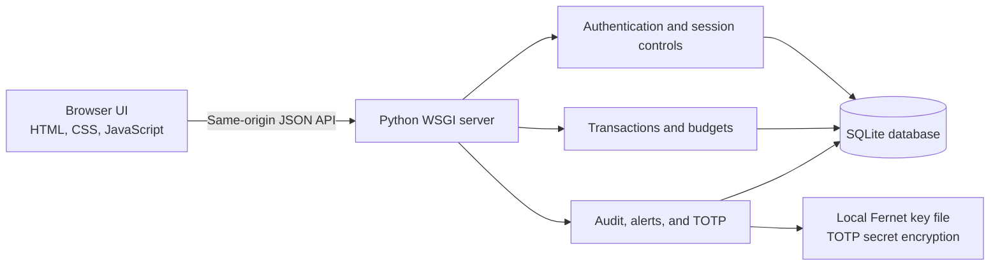

# Smart Expense Tracker
## Cyber-Secure Expense Tracker

**Final-Year Project Report**  
Student: [Student Name]  
Department / College: [Department and College]  
Submission date: [Submission Date]

## Abstract

Smart Expense Tracker is a local full-stack application for recording personal income and expenses, planning a monthly budget, and reviewing spending activity. Its security-focused features include password hashing, server-side sessions, CSRF and same-origin checks, account-scoped database queries, audit events, suspicious-activity alerts, and optional time-based one-time password (TOTP) authentication. The browser client is built with HTML, CSS, and JavaScript; the server uses Python's WSGI standard library and SQLite. TOTP secrets are encrypted with Fernet, while recovery codes are stored as hashes. The application is intended for local education and demonstration, not as a production banking or financial service. Automated tests use disposable databases and synthetic accounts so they do not alter the existing project database.

## Introduction

People often track everyday spending with memory, paper notes, or spreadsheets. Those approaches can make it difficult to see monthly patterns, understand how spending compares with a budget, or preserve a searchable transaction history. A browser-based tracker can combine these workflows in one interface. Because the application handles personal financial information and credentials, its design also needs to demonstrate basic confidentiality, integrity, authentication, and authorization controls.

## Problem Statement

A user needs a straightforward way to enter income and expenses, view category and monthly summaries, and track a spending budget. The application must prevent one account from viewing or changing another account's records and must reduce common web risks such as SQL injection, cross-site scripting, cross-site request forgery, credential guessing, and stolen-session reuse.

## Objectives

- Record and review income and expenses with dates, categories, and optional notes.
- Summarize monthly spending, income, savings rate, budget remainder, and category totals.
- Support transaction search, filtering, creation, editing, deletion, and CSV export.
- Store records persistently in SQLite and scope each user's data to their account.
- Demonstrate layered authentication, session, request-validation, and browser-output protections.
- Provide a security activity dashboard, audit events, alerts, and optional TOTP.
- Keep setup and testing local, dependency-light, and suitable for a student demonstration.

## Existing And Proposed Systems

| Aspect | Manual tracking / basic spreadsheet | Proposed Smart Expense Tracker |
| --- | --- | --- |
| Recording | Entries are typed and summarized manually | Browser forms validate and store entries through a local API |
| Monthly view | Totals and charts require spreadsheet formulas | Dashboard computes monthly metrics and category summaries |
| Search and history | Depends on sheet organization | Searchable transaction ledger with filters and CRUD |
| Account separation | Often a shared file or device | Accounts and records are separated by user ID in database queries |
| Security visibility | Usually no authentication event history | Security page shows account-scoped events and alerts |
| Export | Manual copy or save | CSV download with formula-prefix neutralization |

## Requirements

### Functional Requirements

- Register an account and sign in or sign out.
- Add, edit, delete, search, and filter transactions.
- Set a monthly budget and view income, expenses, savings rate, charts, and category summaries.
- Export the signed-in account's transactions as CSV.
- Review recent security events and alerts, acknowledge alerts, and optionally enroll in or disable TOTP.

### Non-Functional Requirements

- Run locally on Python 3.10 or newer with SQLite; the TOTP encryption dependency is declared in `requirements.txt`.
- Validate API inputs, restrict request bodies, use parameterized SQL, and return generic server errors.
- Keep account data isolated and avoid placing secrets or financial details in audit events.
- Provide a responsive browser interface and protect user-provided text when rendering it.
- Keep security tests isolated from the production database.

## Architecture



The app is a monolith suitable for local coursework. `server.py` serves both static assets and the JSON API. `public/app.js` handles navigation, rendering, and API requests. SQLite holds persistent records. The optional Fernet key file is stored separately from the encrypted TOTP value and must be protected and backed up with the database if TOTP is used.

## Modules

1. **Authentication:** registration, PBKDF2 password verification, session creation and revocation, expiration, and optional TOTP challenge.
2. **Overview:** monthly income/expense metrics, savings rate, six-month spending chart, category breakdown, and recent activity.
3. **Transactions:** validated income/expense CRUD, search, category/type filters, and CSV export.
4. **Budget settings:** account-specific monthly limit stored in integer cents.
5. **Security dashboard:** last-24-hour login counts, recent events, alert acknowledgement, and TOTP status.
6. **Audit and alerts:** minimal event records and heuristic warnings for repeated known-account login failures and authenticated CSRF/origin rejections.
7. **Two-factor authentication:** time-based one-time codes, short-lived enrollment/login challenges, Fernet-encrypted shared secrets, and one-time hashed recovery codes.

## Database Design

| Table | Purpose | Important fields / relationships |
| --- | --- | --- |
| `users` | Account and authentication settings | `id`, `name`, unique `email`, `password_hash`, TOTP enabled state, encrypted active/pending TOTP values, recovery-code hashes |
| `sessions` | Server-side login sessions | Hash of random session token, `user_id`, CSRF token, expiry; user foreign key |
| `transactions` | Financial entries | `id`, `user_id`, title, `amount_cents`, category, kind, date, note; indexed by owner/date |
| `budgets` | Monthly target per account | `user_id` primary/foreign key, `monthly_limit_cents` |
| `security_events` | Minimal account activity history | Nullable `user_id`, event type, severity, timestamp |
| `security_alerts` | Heuristic warning records | `user_id`, type, severity, fixed summary, creation and acknowledgement timestamps |
| `login_challenges` | Short-lived second-factor sign-in state | Challenge-token hash, `user_id`, CSRF hash, expiry, attempt count |

Amounts are stored as integer cents rather than floating-point values. Foreign keys and owner-filtered queries keep financial records scoped to their account. Audit records intentionally omit transaction amounts, descriptions, and notes.

## Security Features

- **Password storage:** PBKDF2-HMAC-SHA256 with a random salt per account and constant-time digest comparison.
- **Session protection:** random opaque IDs, server-side hashed session IDs, seven-day expiration, `HttpOnly`/`SameSite=Lax` cookies, rotation after successful authentication, and revocation of the presented session.
- **CSRF and origin checks:** authenticated changes require a session token and strict localhost Origin/Host matching. Login and registration require a matching localhost origin.
- **Input and SQL controls:** JSON body limit of 64 KB, malformed/duplicate JSON rejection, server-side amount/date/category/title validation, and parameterized SQL.
- **XSS/CSV controls:** user-provided transaction and security text is escaped before HTML insertion. CSV cells beginning with formula-like characters are prefixed to avoid spreadsheet formula execution.
- **HTTP headers:** restrictive Content Security Policy, `nosniff`, frame denial, same-origin resource policy, referrer/permissions policies, and `no-store` responses, including static 404s.
- **Abuse monitoring:** per-IP in-memory throttles and account-scoped repeated-failure alerts. Alerts are indicators for review, not proof of an attack.
- **Optional TOTP:** RFC 6238 six-digit codes with a 30-second period and one-step clock tolerance. Fernet encrypts TOTP secrets; recovery codes are stored as hashes and consumed once.

## Testing Results

The confirmed Phase 4 automated test run used:

```powershell
py -3 -m unittest discover -s tests -v
```

**Result: 25 tests passed, 0 failed.** Test fixtures create temporary SQLite databases and TOTP keys. Coverage includes authentication, registration, session rotation/expiration, CSRF/Origin validation, request limits, authorization and account isolation, SQL-injection-shaped input, transaction and budget CRUD/persistence, audit privacy/scope, alert generation/acknowledgement, headers/error handling, RFC 6238 verification, encrypted TOTP enrollment/login/recovery/disable, and static 404 headers.

Additional browser checks used a second loopback server with a disposable database and synthetic transactions. XSS-shaped transaction text produced zero injected DOM elements and remained text. CSV formula injection and quote escaping were checked against a synthetic formula-like title. The real database was not used for attack payloads or modified by the test suite.

Passing automated tests and these targeted browser checks do not constitute a formal penetration test or prove the absence of all vulnerabilities.

## Limitations

- The built-in WSGI server is for local use and does not provide HTTPS. Do not expose it publicly.
- Rate limiting is in process memory, resets on restart, and is not shared across worker processes. Local users also share one loopback address.
- Audit events and alerts have no retention or pagination policy; event volume can grow the database.
- Financial fields and notes are not encrypted at rest. Protect the SQLite database and its backups with operating-system/storage controls.
- The local TOTP key file must be protected and backed up with the database. Losing it makes encrypted TOTP secrets unusable.
- Known-account failures can produce false alerts; unknown-email attempts are not attributable to a user. The detector does not collect IP/device/location context, send notifications, or detect all password-spraying patterns.
- The demo account has public fixed credentials. There is no self-service password-reset/email recovery, centralized alert delivery, or account-wide session revocation UI.

## Conclusion

The project combines everyday expense tracking with practical web-security controls that can be inspected and demonstrated locally. It preserves transaction, budget, chart, and export workflows while adding account-scoped security visibility and opt-in second-factor authentication. Its most important operating constraint is that it remains an educational local application, not a production financial service.

## Future Enhancements

- Use a shared rate-limit store and monitoring for multi-worker deployment.
- Add event/alert retention, pagination, and configurable history limits.
- Add a verified password recovery process and account-wide session management.
- Use a managed secret store and encrypted/managed database storage for deployment.
- Add CI checks, dependency monitoring, backup/restore drills, and a reviewed HTTPS deployment configuration.
- Improve alert context without logging secrets or unnecessary financial details.